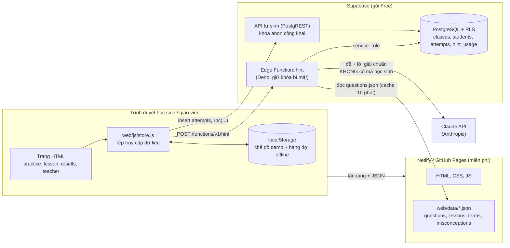
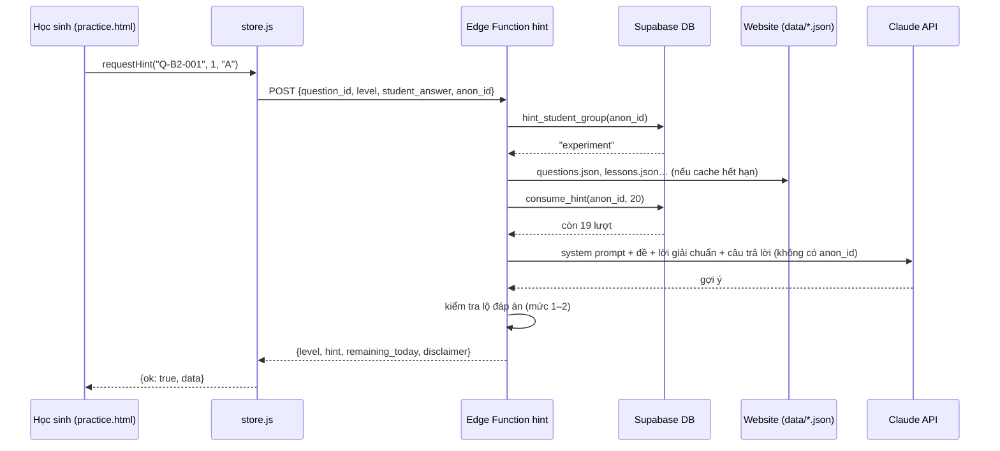

# Kiến trúc kỹ thuật – NVT SMART CHEMISTRY

> Tài liệu ràng buộc chung: `docs/CONTRACT.md`. Nếu tài liệu này mâu thuẫn với CONTRACT, CONTRACT thắng và phải sửa tài liệu này.
> Tài liệu liên quan: [DATA_MODEL.md](DATA_MODEL.md) · [AI_TUTOR_DESIGN.md](AI_TUTOR_DESIGN.md) · [CODING_GUIDE.md](CODING_GUIDE.md)

## 1. Tổng quan

Hệ thống gồm 3 phần, đều dùng gói miễn phí hoặc trả theo lượt dùng:

1. **Website tĩnh** (`web/`): HTML + CSS + JavaScript thuần, không framework, không bước build. Lưu trữ miễn phí trên **Netlify** hoặc **GitHub Pages**. Nội dung học (bài học, thuật ngữ, câu hỏi, lỗi sai) là các file JSON trong `web/data/`.
2. **Supabase** (gói Free): cơ sở dữ liệu PostgreSQL lưu kết quả làm bài ẩn danh, bảo vệ bằng **Row Level Security (RLS)**; một **Edge Function** tên `hint`.
3. **Claude API** (Anthropic): chỉ được gọi từ Edge Function `hint` để sinh gợi ý 3 mức.



### Luồng xin gợi ý AI



## 2. Hai chế độ chạy: demo và online

CONTRACT mục 6 yêu cầu mọi màn hình chạy được **khi chưa có Supabase**. `store.js` tự chọn chế độ:

| | **Demo** | **Online** |
|---|---|---|
| Khi nào | `web/js/config.js` để trống `SUPABASE_URL`, **hoặc** địa chỉ có `?demo=1` | `config.js` có `SUPABASE_URL` và `SUPABASE_ANON_KEY` |
| Đăng nhập | Chấp nhận mọi mã lớp/mã học sinh hợp lệ về định dạng; mã lớp `DEMO-DC` được coi là lớp đối chứng | Kiểm tra bằng RPC `login_student` |
| Lưu bài làm | `localStorage` (khóa `nvt.attempts`) | Bảng `attempts`; nếu mất mạng thì xếp hàng trong `localStorage` (khóa `nvt.pending`) và gửi lại sau |
| Thống kê cá nhân | Tính từ `localStorage` | RPC `get_my_stats` |
| Dashboard giáo viên | Tính từ `localStorage` của máy đó + dữ liệu mẫu; PIN demo: `demo-gv-2026` | RPC `get_class_stats` (yêu cầu PIN) |
| Gợi ý AI | **Gợi ý soạn sẵn, không gọi AI**: mức 1 = câu hỏi gợi mở chung; mức 2 = `remedy` của lỗi sai tương ứng trong `misconceptions.json`; mức 3 = `explanation` của câu hỏi. Giới hạn 20 lượt/ngày đếm trong `localStorage` | Edge Function `hint` gọi Claude |
| Cần mạng? | Không (sau khi tải trang) | Có |

Chế độ demo cũng là **phương án dự phòng khi trình diễn** ở hội thi: nếu Wi-Fi hỏng, mở `?demo=1` vẫn trình bày được toàn bộ luồng.

`web/js/config.js` (agent giao diện tạo, nhóm điền giá trị):

```js
// Khóa anon là khóa CÔNG KHAI, được phép để ở đây vì cơ sở dữ liệu đã bật RLS.
// TUYỆT ĐỐI không đặt ANTHROPIC_API_KEY hay service_role key ở đây.
export const CONFIG = {
  SUPABASE_URL: "",        // ví dụ "https://abcd1234.supabase.co"; để trống = chế độ demo
  SUPABASE_ANON_KEY: "",   // Project Settings → API → anon / publishable key
  HINT_DAILY_LIMIT: 20,    // chỉ dùng để hiển thị và cho chế độ demo
};
```

## 3. Lớp truy cập dữ liệu `web/js/store.js`

Mọi trang **chỉ** đọc/ghi dữ liệu người dùng qua `store.js`. Trang không gọi `fetch` tới Supabase, không đọc `localStorage` trực tiếp (trừ cài đặt giao diện như chế độ sáng/tối). Nhờ vậy đổi demo ↔ online không phải sửa trang nào.

### 3.1 Quy ước chung

- `store.js` là ES module. Thư viện Supabase chỉ được nạp **khi ở chế độ online**, bằng `import()` động từ CDN có ghi rõ phiên bản:
  `await import("https://cdn.jsdelivr.net/npm/@supabase/supabase-js@2.45.4/+esm")`. Chế độ demo không cần mạng.
- Mọi hàm bất đồng bộ trả về **cùng một dạng**, không ném lỗi ra trang:
  ```js
  { ok: true, data: … }                          // thành công
  { ok: false, error: "MÃ_LỖI", message: "…" }   // thất bại; message là tiếng Việt, hiển thị được ngay
  ```
- Tên hàm: `camelCase`. Khóa trong dữ liệu: `snake_case`, giống hệt cột CSDL và JSON trong CONTRACT (ví dụ `question_id`, `hint_level_used`).
- Mã học sinh và mã lớp luôn được `trim()` và viết HOA trước khi dùng.

### 3.2 Danh sách hàm

| Hàm | Trả về `data` | Ghi chú |
|---|---|---|
| `getMode()` → `"demo" \| "online"` | (đồng bộ, không bọc `ok`) | Dùng để hiện nhãn "Chế độ demo" |
| `login(classCode, anonId)` | `{ anon_id, class_code, class_name, group }` | Lưu phiên vào `localStorage` (khóa `nvt.session`). Lỗi: `UNKNOWN_STUDENT`, `NETWORK` |
| `getSession()` → phiên hoặc `null` | (đồng bộ) | Trang cần đăng nhập kiểm tra hàm này |
| `logout()` | (đồng bộ) | Xóa `nvt.session`, giữ hàng đợi chưa gửi |
| `saveAttempt(attempt)` | `{ id, queued }` | `queued: true` nghĩa là đang chờ mạng. Lỗi: `NOT_LOGGED_IN`, `INVALID_INPUT` |
| `flushPendingAttempts()` | `{ sent, remaining }` | Gọi khi tải trang và khi sự kiện `online` xảy ra |
| `getMyStats()` | đối tượng thống kê cá nhân (3.4) | Lỗi: `NOT_LOGGED_IN`, `UNKNOWN_STUDENT`, `NETWORK` |
| `getClassStats(classCode, teacherPin, mode = null)` | đối tượng thống kê lớp (3.4) | `mode`: `null` \| `"practice"` \| `"pretest"` \| `"posttest"`. Lỗi: `INVALID_PIN`, `NETWORK` |
| `getClassExport(classCode, teacherPin)` | mảng dòng bài làm (ẩn danh) | Trang giáo viên đổi thành CSV để tải về. Lỗi: `INVALID_PIN` |
| `requestHint(questionId, level, studentAnswer)` | `{ level, hint, remaining_today, disclaimer }` | Tự lấy `anon_id` từ phiên. Lỗi: xem 3.5 |
| `getHintsRemaining()` | `number` | Số lượt còn lại hôm nay (từ phản hồi gợi ý gần nhất / bộ đếm demo) |

Nội dung tĩnh (`web/data/*.json`) **không** đi qua `store.js`; agent giao diện đọc bằng `fetch("data/questions.json")` trong module riêng (ví dụ `web/js/content.js`).

### 3.3 Đối tượng `attempt` truyền vào `saveAttempt`

```js
{
  question_id: "Q-B2-001",
  lesson: "B2",                       // B1 | B2 | B3 | B4
  answer: "A",                        // mcq: "A"; true_false: {a:true,b:false,c:true,d:false}; short: "35.5"
  is_correct: false,
  misconception_codes: ["M1"],        // mã lỗi của phương án/ý học sinh chọn sai; [] nếu đúng
  hint_level_used: 2,                 // mức gợi ý cao nhất đã xem cho câu này (0 = không xem)
  duration_ms: 41250,
  mode: "practice"                    // practice | pretest | posttest
}
```

`store.js` tự thêm `id` (`crypto.randomUUID()`) và `anon_id` từ phiên. Khi gửi lại từ hàng đợi, trùng `id` (lỗi Postgres `23505`) được coi là **đã gửi thành công**. Lưu ý khi chèn bằng supabase-js: dùng `.insert(row)` **không** kèm `.select()` vì học sinh không có quyền đọc bảng.

Ở `pretest`/`posttest`, giao diện **không hiện nút gợi ý** và `hint_level_used` phải bằng 0 (CSDL cũng chặn).

### 3.4 Dạng dữ liệu thống kê

`getMyStats()`:

```json
{
  "total_attempts": 25, "correct": 13, "accuracy": 0.52, "hints_used": 3, "hints_today": 0,
  "by_lesson":        [{ "lesson": "B1", "attempts": 7, "correct": 2 }],
  "by_misconception": [{ "code": "M3", "count": 3 }],
  "by_mode":          [{ "mode": "practice", "attempts": 9, "accuracy": 0.444 }]
}
```

`getClassStats(...)`:

```json
{
  "class": { "code": "DEMO-TN", "name": "Lớp demo – Thực nghiệm", "group": "experiment" },
  "mode": null,
  "students_total": 10, "students_active": 10, "total_attempts": 241, "accuracy": 0.544,
  "by_misconception": [{ "code": "M6", "count": 17, "students": 10 }],
  "by_lesson":        [{ "lesson": "B1", "attempts": 61, "accuracy": 0.525 }],
  "by_question":      [{ "question_id": "Q-B3-003", "lesson": "B3", "attempts": 30, "accuracy": 0.433 }],
  "hint_levels":      [{ "level": 1, "count": 15 }],
  "scores":           [{ "mode": "pretest", "students": 10, "avg_score": 0.513 }]
}
```

`accuracy` là số thập phân 0–1 (hoặc `null` khi chưa có bài làm). Trang tự đổi sang %. `by_question` chỉ gồm 20 câu có tỉ lệ đúng thấp nhất. Tên lỗi sai (M1 → "Nhầm số khối…") lấy từ `misconceptions.json` phía giao diện. Chế độ demo phải trả về **đúng dạng** này.

### 3.5 Bảng mã lỗi

| Mã | Nguồn | HTTP (hint) | Giao diện nên làm gì |
|---|---|---|---|
| `NOT_LOGGED_IN` | store.js | – | Chuyển về `index.html` để đăng nhập |
| `UNKNOWN_STUDENT` | RPC / hint | 403 | "Mã lớp hoặc mã học sinh không đúng" |
| `INVALID_PIN` | RPC | – | "PIN không đúng" (máy chủ cố ý chờ 1 giây) |
| `INVALID_INPUT` | store.js / hint | 400 | Lỗi lập trình – ghi `console.error` |
| `HINTS_DISABLED` | hint | 403 | Ẩn nút gợi ý (lớp đối chứng) |
| `QUESTION_NOT_FOUND` | hint | 404 | Câu hỏi chưa có trên website đã deploy |
| `RATE_LIMITED` | hint | 429 | "Hết lượt gợi ý hôm nay", khóa nút; vẫn cho xem lời giải chuẩn |
| `AI_BUSY` / `AI_UNAVAILABLE` / `CONTENT_UNAVAILABLE` | hint | 503 / 502 / 503 | Hiện thông báo, gợi ý xem lời giải chuẩn; lượt không bị trừ |
| `SERVER_ERROR` | hint | 500 | Thử lại sau |
| `NETWORK` | store.js | – | "Mất kết nối" – bài làm vẫn được xếp hàng |

`requestHint` gửi kèm header `apikey: SUPABASE_ANON_KEY` và `Authorization: Bearer SUPABASE_ANON_KEY` (hoặc dùng `supabase.functions.invoke("hint", { body })`, tự gửi header). Body và phản hồi đúng như CONTRACT mục 4.

## 4. Mô hình bảo mật

| Bí mật / tài nguyên | Ở đâu | Ai thấy được |
|---|---|---|
| `SUPABASE_ANON_KEY` | `web/js/config.js` (công khai) | Bất kỳ ai mở website – **chấp nhận được** vì RLS chỉ cho phép đúng các thao tác liệt kê dưới đây |
| `SUPABASE_SERVICE_ROLE_KEY` | Tự có trong Edge Function | Chỉ Edge Function. **Không bao giờ** đưa vào `web/` |
| `ANTHROPIC_API_KEY` | `supabase secrets` của Edge Function | Chỉ Edge Function. Không nằm trong mã nguồn, không commit Git |
| PIN giáo viên | Chỉ lưu **bản băm bcrypt** trong `classes.teacher_pin_hash` | Không ai đọc được PIN gốc, kể cả nhóm |

Với khóa anon, người dùng chỉ có thể:

1. `INSERT` vào `attempts` khi `anon_id` đã được giáo viên tạo (chính sách RLS); không tự đặt `created_at`.
2. Gọi 4 RPC: `login_student`, `get_my_stats` (chỉ số tổng hợp), `get_class_stats` và `get_class_export` (cả hai **bắt buộc đúng PIN**).

Không có quyền `SELECT`, `UPDATE`, `DELETE` trực tiếp trên bảng nào ⇒ không xem được bài làm của bạn khác, không sửa/xóa dữ liệu thực nghiệm. Đã kiểm thử bằng vai trò `anon` trên PostgreSQL 17 (xem DATA_MODEL.md mục 6).

**Bảo vệ dashboard giáo viên**: `teacher.html` là trang công khai nhưng **không có dữ liệu** cho tới khi nhập đúng mã lớp + PIN. PIN được kiểm tra trong CSDL (không kiểm tra bằng JavaScript phía trình duyệt). Sai PIN phải chờ 1 giây ⇒ dò PIN rất chậm. Yêu cầu PIN **ít nhất 8 ký tự**, mỗi lớp một PIN, không dùng lại PIN demo. Trang giữ PIN trong `sessionStorage` (mất khi đóng tab), không lưu `localStorage`.

**Giới hạn đã biết (nói thật với giám khảo)**:
- Học sinh đăng nhập bằng mã ẩn danh, không có mật khẩu. Một bạn biết mã của bạn khác có thể gửi bài làm giả dưới mã đó hoặc xem thống kê tổng hợp của mã đó. Rủi ro thấp vì dữ liệu không chứa thông tin cá nhân, thực nghiệm làm tại lớp có giáo viên giám sát, và giáo viên phát mã trên phiếu riêng.
- `is_correct` do trình duyệt tính. Một học sinh rành kỹ thuật có thể gửi kết quả sai lệch. Với bài pre-test/post-test, giáo viên có thể đối chiếu với phiếu giấy dự phòng.
- Đáp án nằm trong `questions.json` công khai (cần cho chấm điểm tức thì khi ôn tập). Đây là công cụ **ôn tập**, không phải phần mềm thi; bài kiểm tra trước/sau làm tại lớp có giám sát.
- Edge Function không cần đăng nhập Supabase Auth; chống lạm dụng bằng: mã học sinh phải tồn tại, chỉ lớp thực nghiệm, 20 lượt/học sinh/ngày, hạn mức chi tiêu trên tài khoản Anthropic.

**Quyền riêng tư** (CONTRACT mục 5, Kế hoạch mục 7): không thu thập họ tên, email, số điện thoại. Edge Function **không gửi `anon_id`** cho Claude và không ghi `anon_id` cùng câu trả lời vào nhật ký. Theo điều khoản thương mại của Anthropic, dữ liệu gửi qua API mặc định không được dùng để huấn luyện mô hình (nhóm nên đọc lại chính sách hiện hành trước khi nộp hồ sơ và trích dẫn trong báo cáo).

## 5. Ước tính chi phí

| Hạng mục | Gói | Chi phí |
|---|---|---|
| Netlify / GitHub Pages | Free | 0 đ |
| Supabase | Free (500 MB CSDL, 500.000 lượt gọi Edge Function/tháng) | 0 đ |
| Claude API | Trả theo token | xem dưới |

Mỗi lượt gợi ý ≈ 1.500 token vào (system prompt + bài học + đề + lời giải) và ≈ 400 token ra (gồm phần suy nghĩ ngắn ở `effort: "low"`).

| Mô hình | Giá (vào / ra, USD mỗi 1 triệu token) | ≈ USD / lượt | 1.600 lượt (thực tế: 40 HS × 8 lượt × 5 ngày) | 4.000 lượt (tối đa: 40 HS × 20 × 5) |
|---|---|---|---|---|
| `claude-opus-5-5` (mặc định) | 4 / 20 | 0,014 | ≈ 22 USD | ≈ 56 USD |
| `claude-haiku-5-5` | 0,10 / 0,50 | 0,00035 | ≈ 0,6 USD | ≈ 1,4 USD |

Khuyến nghị: chạy bộ kiểm thử 30 câu (`ai_test_cases.md`) trên **cả hai** mô hình. Nếu Haiku đạt ngưỡng chất lượng (AI_TUTOR_DESIGN.md mục 7), dùng Haiku cho thực nghiệm để tiết kiệm. Luôn đặt **spend limit** (ví dụ 10–30 USD) trên tài khoản Anthropic. Đây là quyết định của nhóm và giáo viên hướng dẫn; ghi lại trong `docs/management/AI_USAGE_LOG.md`.

⚠ Dự án Supabase gói Free **tự tạm dừng sau 7 ngày không có truy cập**. Trước buổi thực nghiệm và trước ngày thi, mở Dashboard kiểm tra dự án đang "Active".

## 6. Triển khai từng bước (cho người mới)

**Bước 1 – Tạo dự án Supabase** (≈ 10 phút)
1. Vào <https://supabase.com> → đăng nhập bằng GitHub → **New project**. Đặt tên `nvt-smart-chemistry`, chọn vùng **Southeast Asia (Singapore)**, lưu mật khẩu CSDL vào nơi an toàn.
2. **SQL Editor** → **New query** → dán toàn bộ `supabase/schema.sql` → **Run**. Lặp lại với `supabase/seed.sql`.
3. **Project Settings → API**: chép **Project URL** và **anon public key** vào `web/js/config.js`.

**Bước 2 – Tạo lớp thật** (giáo viên cùng làm, trong SQL Editor)
```sql
select public.admin_upsert_class('10A1', 'Lớp 10A1', '<PIN-it-nhat-8-ky-tu>', 'experiment');
select public.admin_upsert_class('10A2', 'Lớp 10A2', '<PIN-khac>', 'control');
select public.admin_add_students('10A1', '10A1', 45);   -- tạo 10A1-01 … 10A1-45
select public.admin_add_students('10A2', '10A2', 45);
```
Giáo viên in danh sách mã, cắt thành phiếu, phát ngẫu nhiên. **Bảng ghép mã ↔ họ tên (nếu cần để ghép phiếu đồng ý) do giáo viên giữ trên giấy, không đưa lên hệ thống.**

**Bước 3 – Đưa website lên mạng**
- *Netlify (khuyên dùng)*: <https://app.netlify.com/drop> → kéo thả thư mục `web/` → nhận địa chỉ dạng `https://ten-ngau-nhien.netlify.app` (đổi tên trong Site settings). Hoặc kết nối GitHub, đặt **Publish directory** = `web`, **Build command** để trống.
- *GitHub Pages*: Settings → Pages → Deploy from branch. Vì Pages chỉ phục vụ thư mục gốc hoặc `/docs`, dùng GitHub Actions "Static HTML" với `path: web`.

**Bước 4 – Triển khai Edge Function**: làm theo `supabase/functions/hint/README.md` (đặt `ANTHROPIC_API_KEY`, `CONTENT_BASE_URL` = địa chỉ website + `/data`, `ALLOWED_ORIGIN` = địa chỉ website; rồi `deploy`).

**Bước 5 – Kiểm tra**: đăng nhập `DEMO-TN` / `TN-01`, làm 3 câu, xin gợi ý 3 mức; mở `teacher.html`, nhập `DEMO-TN` + `demo-gv-2026`. Chạy bộ kiểm thử AI.

## 7. Vì sao chọn như vậy? (để trả lời giám khảo)

- **HTML/CSS/JS thuần, không framework**: cả 3 thành viên đều đọc hiểu và tự giải thích được từng dòng mã; không có bước build dễ hỏng; chạy trên mọi điện thoại.
- **Website tĩnh + Netlify/GitHub Pages**: miễn phí, nhanh, không cần quản lý máy chủ.
- **Supabase**: là PostgreSQL thật (kiến thức SQL dùng được lâu dài), gói miễn phí đủ cho vài lớp, có sẵn **Row Level Security** để bảo vệ dữ liệu ngay trong CSDL thay vì tự viết máy chủ.
- **Edge Function giữ khóa AI**: khóa API không bao giờ xuống trình duyệt; máy chủ tự đọc đề và lời giải chuẩn nên học sinh không thể "lừa" AI bằng cách sửa đề.
- **Câu hỏi để trong JSON, không nhân bản vào CSDL**: một nguồn dữ liệu duy nhất do nhóm nội dung và giáo viên duyệt; sửa một chỗ, cả website và AI cùng cập nhật.
- **AI gợi ý 3 mức, có hậu kiểm**: AI dựa trên lời giải đã được giáo viên duyệt, không đưa đáp án ở mức 1–2; có bộ kiểm thử 30 câu với số liệu cụ thể.
- **Chế độ demo**: sản phẩm chạy được cả khi không có mạng – an toàn cho buổi trình diễn.
- **Ẩn danh từ thiết kế**: hệ thống không có cột nào để lưu họ tên.
- **Chi phí gần như bằng 0** ngoài tiền gọi AI, và tiền AI được giới hạn bằng số lượt/ngày + hạn mức chi tiêu.
