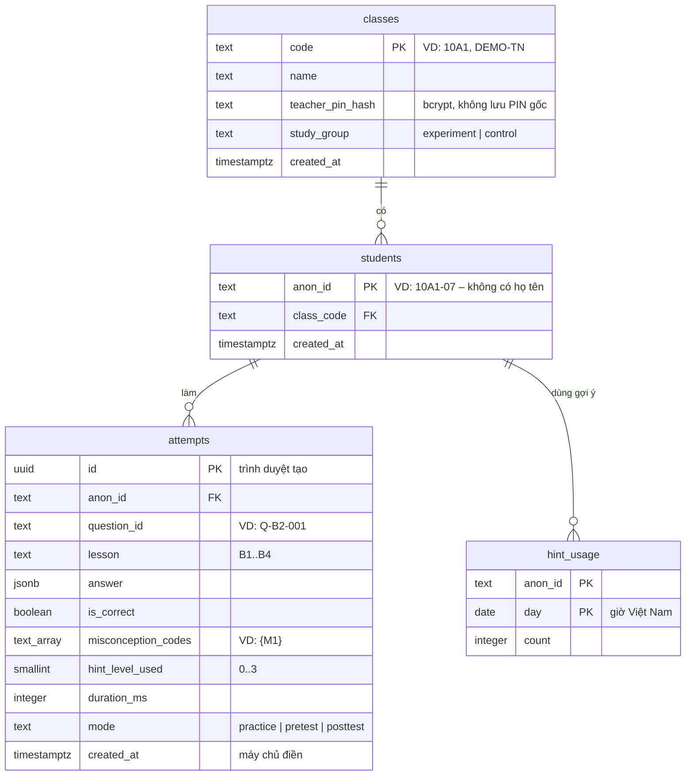

# Mô hình dữ liệu – NVT CHEMZ

Mã nguồn: [`supabase/schema.sql`](../../supabase/schema.sql) (cấu trúc + bảo mật) và [`supabase/seed.sql`](../../supabase/seed.sql) (dữ liệu mẫu). File `schema.sql` là bản gốc; tài liệu này giải thích.

## 1. Hai loại dữ liệu

| Loại | Lưu ở đâu | Ai sửa |
|---|---|---|
| **Nội dung học**: bài học, thuật ngữ, câu hỏi + đáp án + lời giải, danh mục lỗi sai | `web/data/*.json` (CONTRACT mục 3) | Nhóm nội dung, giáo viên duyệt |
| **Dữ liệu sử dụng**: lớp, mã học sinh ẩn danh, bài làm, lượt gợi ý | Supabase PostgreSQL | Hệ thống tự ghi |

### Quyết định: câu hỏi KHÔNG có bảng trong CSDL

Edge Function `hint` cần đọc đề, đáp án và `explanation` theo `question_id`. Đã cân nhắc 3 cách:

| Cách | Ưu | Nhược |
|---|---|---|
| A. Bảng `questions` trong CSDL | Truy vấn SQL được | Hai bản sao (JSON + CSDL) dễ lệch nhau; phải viết script đồng bộ |
| B. Đóng gói bản sao `questions.json` vào thư mục Edge Function | Không phụ thuộc website | Mỗi lần sửa câu hỏi phải nhớ chép file **và** deploy lại hàm – dễ quên |
| **C. Edge Function tải `questions.json` từ địa chỉ website** ✅ | **Một nguồn duy nhất**; sửa JSON → deploy website → AI tự cập nhật sau ≤ 10 phút | Cần website đang chạy; thêm 1 lượt tải mỗi 10 phút |

Chọn **C**. Địa chỉ đặt bằng biến `CONTENT_BASE_URL` (ví dụ `https://nvt-chemz.vercel.app/data`); hàm tải `questions.json`, `lessons.json`, `misconceptions.json`, `terms.json` và giữ trong bộ nhớ 10 phút. Địa chỉ do máy chủ cấu hình, trình duyệt không thể đổi ⇒ học sinh không thể đưa đề giả cho AI. Thống kê theo câu hỏi chỉ cần `question_id` và `lesson` (đã lưu trong `attempts`); tên câu và tên lỗi sai được giao diện ghép từ JSON.

## 2. Sơ đồ quan hệ



## 3. Chi tiết bảng

### `classes`
| Cột | Kiểu | Ràng buộc |
|---|---|---|
| `code` | text | Khóa chính, chữ HOA/số/gạch ngang, 2–20 ký tự |
| `name` | text | ≤ 80 ký tự |
| `teacher_pin_hash` | text | `crypt(pin, gen_salt('bf'))` – bcrypt |
| `study_group` | text | `'experiment'` hoặc `'control'`. (Không đặt tên `group` vì đó là từ khóa SQL; RPC trả ra khóa JSON `"group"`.) |

### `students`
| Cột | Kiểu | Ràng buộc |
|---|---|---|
| `anon_id` | text | Khóa chính, chữ HOA/số/gạch ngang, 3–30 ký tự |
| `class_code` | text | → `classes.code`, xóa lớp thì xóa học sinh |

Không có cột họ tên, email, số điện thoại, ngày sinh – **cố ý**.

### `attempts`
| Cột | Kiểu | Ghi chú |
|---|---|---|
| `id` | uuid | Trình duyệt tạo bằng `crypto.randomUUID()`; gửi lại không bị trùng |
| `anon_id` | text | Phải tồn tại trong `students` (RLS + khóa ngoại) |
| `question_id` | text | Khớp `id` trong `questions.json` |
| `lesson` | text | `B1`–`B4` |
| `answer` | jsonb | ≤ 2 KB. mcq: `"A"`; true_false: `{"a":true,…}`; short: `"35.5"` |
| `is_correct` | boolean | Với true_false: đúng khi cả 4 ý đúng (giao diện tính) |
| `misconception_codes` | text[] | Mã lỗi sai của lựa chọn sai, tối đa 10 mã |
| `hint_level_used` | smallint | 0 = không xem gợi ý; 1–3 = mức cao nhất đã xem |
| `duration_ms` | integer | 0 – 3.600.000 |
| `mode` | text | `practice` / `pretest` / `posttest`. Ràng buộc: ngoài `practice` thì `hint_level_used = 0` |
| `created_at` | timestamptz | Máy chủ điền, trình duyệt không được ghi |

### `hint_usage`
Khóa chính (`anon_id`, `day`). `day` tính theo giờ Việt Nam (`vn_today()`), nên bộ đếm về 0 lúc 0 giờ sáng Việt Nam. Chỉ Edge Function ghi (qua `consume_hint` / `refund_hint`).

## 4. Bảo mật: quyền và RLS

Tất cả bảng **bật RLS** và **thu hồi mọi quyền** của vai trò `anon`/`authenticated`, sau đó chỉ cấp lại đúng những gì cần:

| Thao tác bằng khóa anon (website) | `classes` | `students` | `attempts` | `hint_usage` |
|---|---|---|---|---|
| SELECT | ✗ | ✗ | ✗ | ✗ |
| INSERT | ✗ | ✗ | ✓ nếu `is_registered_student(anon_id)`; chỉ các cột dữ liệu, không có `created_at` | ✗ |
| UPDATE / DELETE | ✗ | ✗ | ✗ | ✗ |

Đọc dữ liệu chỉ qua hàm RPC `SECURITY DEFINER` (chạy với quyền chủ sở hữu nhưng tự kiểm tra điều kiện):

| RPC | Ai gọi | Kiểm tra | Trả về |
|---|---|---|---|
| `login_student(p_class_code, p_anon_id)` | website | mã lớp + mã HS khớp | `{anon_id, class_code, class_name, group}` hoặc `null` |
| `get_my_stats(p_class_code, p_anon_id)` | website | mã HS thuộc lớp; sai ⇒ lỗi `UNKNOWN_STUDENT` | thống kê tổng hợp (ARCHITECTURE.md 3.4) |
| `get_class_stats(p_class_code, p_teacher_pin, p_mode default null)` | teacher.html | PIN bcrypt; sai ⇒ chờ 1 giây, lỗi `INVALID_PIN` | thống kê lớp (ARCHITECTURE.md 3.4) |
| `get_class_export(p_class_code, p_teacher_pin)` | teacher.html | như trên | bảng: `anon_id, question_id, lesson, is_correct, misconception_codes, hint_level_used, duration_ms, mode, created_at` |
| `hint_student_group(p_anon_id)` | **chỉ** Edge Function (service_role) | – | `'experiment'` / `'control'` / `null` |
| `consume_hint(p_anon_id, p_limit)` | **chỉ** Edge Function | nguyên tử (`insert … on conflict … where count < limit`) | số lượt còn lại, hoặc `-1` nếu hết |
| `refund_hint(p_anon_id)` | **chỉ** Edge Function | – | hoàn 1 lượt khi AI lỗi |
| `admin_upsert_class(code, name, pin, group)` | **chỉ** SQL Editor | – | tạo/sửa lớp, băm PIN |
| `admin_add_students(class_code, prefix, count)` | **chỉ** SQL Editor | – | tạo `PREFIX-01…PREFIX-NN`, trả số mã mới |

Khi supabase-js gọi RPC bị `raise exception 'INVALID_PIN'`, lỗi trả về có `error.message === "INVALID_PIN"` (tương tự `UNKNOWN_STUDENT`); `store.js` đổi thành `{ ok: false, error: "INVALID_PIN", message: "PIN không đúng." }`.

## 5. Dữ liệu mẫu (`seed.sql`)

| Mã lớp | Tên | Nhóm | PIN | Mã học sinh |
|---|---|---|---|---|
| `DEMO-TN` | Lớp demo – Thực nghiệm | experiment | `demo-gv-2026` | `TN-01` … `TN-10` |
| `DEMO-DC` | Lớp demo – Đối chứng | control | `demo-gv-2026` | `DC-01` … `DC-10` |

`DEMO-TN` có sẵn 240 bài làm mẫu (8 câu × 3 chế độ × 10 học sinh), tạo theo hàm băm nên mỗi lần chạy cho kết quả giống nhau; post-test có tỉ lệ đúng cao hơn pre-test để dashboard minh họa được. **Dữ liệu mẫu không phải số liệu thực nghiệm – không đưa vào báo cáo.** Trước thực nghiệm thật có thể xóa: `delete from public.classes where code like 'DEMO-%';`

## 6. Đã kiểm thử

`schema.sql` + `seed.sql` đã chạy trên PostgreSQL 17 (Docker), chạy lại lần 2 không lỗi. Kiểm thử với vai trò `anon`:

| Thử | Kết quả |
|---|---|
| `login_student('demo-tn','tn-01')` | trả thông tin lớp (tự viết HOA) |
| INSERT bài làm của `TN-01` | ✓ |
| INSERT với `anon_id` không tồn tại | ✗ vi phạm chính sách RLS |
| INSERT tự đặt `created_at` | ✗ permission denied |
| INSERT `pretest` có `hint_level_used = 2` | ✗ vi phạm ràng buộc |
| `select … from attempts` / `students` | ✗ permission denied |
| `get_class_stats` sai PIN / đúng PIN | ✗ `INVALID_PIN` / ✓ JSON đầy đủ |
| `consume_hint` bằng anon | ✗ permission denied |
| `consume_hint(…, 2)` ba lần bằng service_role | 1, 0, −1 |

## 7. Truy vấn phân tích cho báo cáo

Xuất dữ liệu: dashboard giáo viên → "Tải CSV" (dùng `get_class_export`). Hoặc trong SQL Editor:

```sql
-- Điểm pre-test và post-test của từng học sinh (tỉ lệ đúng) – dùng cho t-test ghép cặp
select s.class_code, a.anon_id,
       round(avg(a.is_correct::int) filter (where a.mode = 'pretest'), 3)  as pre,
       round(avg(a.is_correct::int) filter (where a.mode = 'posttest'), 3) as post
from public.attempts a join public.students s using (anon_id)
where s.class_code in ('10A1', '10A2')
group by s.class_code, a.anon_id
having count(*) filter (where a.mode = 'pretest') > 0
   and count(*) filter (where a.mode = 'posttest') > 0
order by 1, 2;

-- Tỉ lệ mắc từng lỗi sai trước và sau (số lượt mắc / số học sinh)
select s.class_code, a.mode, m.code, count(*) as times, count(distinct a.anon_id) as students
from public.attempts a
join public.students s using (anon_id)
cross join lateral unnest(a.misconception_codes) as m(code)
where a.mode in ('pretest', 'posttest')
group by 1, 2, 3
order by 1, 3, 2;
```

Lưu ý: lớp đối chứng ôn bằng phiếu giấy nhưng **vẫn có thể làm pre-test/post-test trên website** (không có nút gợi ý AI) để số liệu cùng định dạng. Nếu làm trên giấy, nhập điểm vào bảng tính riêng.
