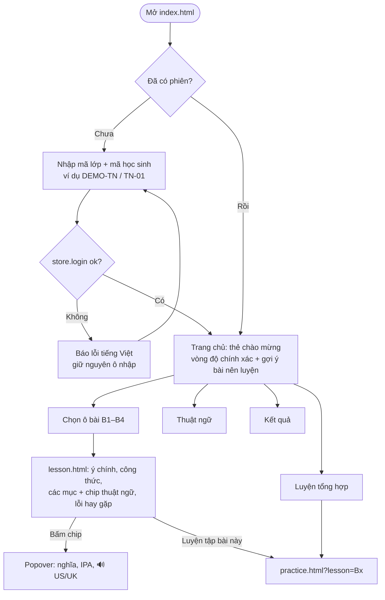
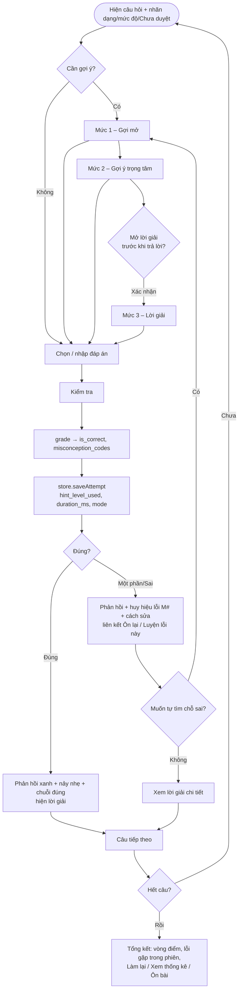
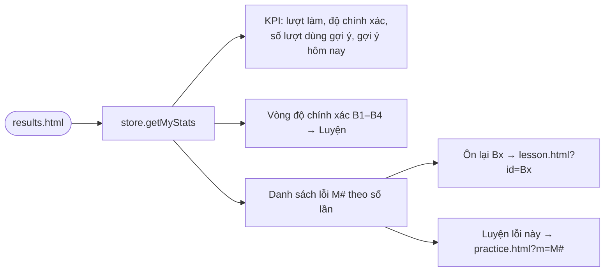
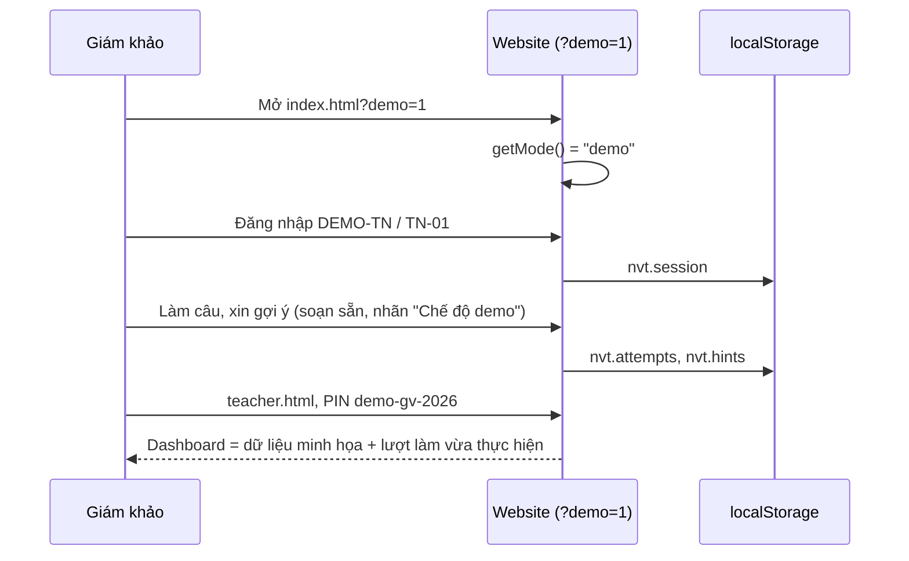

# Luồng trải nghiệm (UX flows)

Các sơ đồ dưới đây mô tả hành trình chính trên website. Tên trang khớp với tệp trong `web/`. Dữ liệu người dùng luôn đi qua `web/js/store.js` (xem `docs/architecture/ARCHITECTURE.md` §3).

## 1. Học sinh – đăng nhập và ôn tập



## 2. Học sinh – trả lời một câu hỏi (practice.html)



Biến thể:
- **Lớp đối chứng** (`group = control`) – không hiện thang gợi ý; sau khi trả lời hiện lời giải ngay.
- **Kiểm tra trước/sau** (`practice.html?mode=pretest|posttest`) – không gợi ý, không phản hồi từng câu, `hint_level_used = 0`; chỉ hiện tổng kết cuối bài.
- **Hết lượt gợi ý / AI lỗi** (`RATE_LIMITED`, `AI_BUSY`, `NETWORK`…) – thông báo ngắn, khóa nút gợi ý, vẫn cho "Xem lời giải chi tiết".

## 3. Học sinh – xem kết quả và ôn lỗi sai



## 4. Giáo viên – dashboard lớp

```mermaid
flowchart TD
  T([teacher.html]) --> L[Nhập mã lớp + PIN]
  L --> V{store.getClassStats ok?}
  V -- INVALID_PIN --> E[Báo "PIN không đúng"] --> L
  V -- ok --> D[Dashboard]
  D --> F[Lọc: Tất cả / Luyện tập / KT trước / KT sau]
  F --> D
  D --> C1[Độ chính xác theo bài]
  D --> C2[Tỉ lệ học sinh mắc từng lỗi]
  D --> C3[Điểm TB KT trước vs KT sau]
  D --> C4[Bản đồ nhiệt bài × mã lỗi<br/>từ getClassExport]
  D --> C5[Câu khó nhất + lỗi chính]
  D --> X1[CSV lượt làm → phân tích t-test]
  D --> X2[CSV lỗi sai theo bài]
  D --> O[Thoát → xóa PIN khỏi sessionStorage]
```

## 5. Trình diễn tại hội thi (dự phòng mất mạng)


