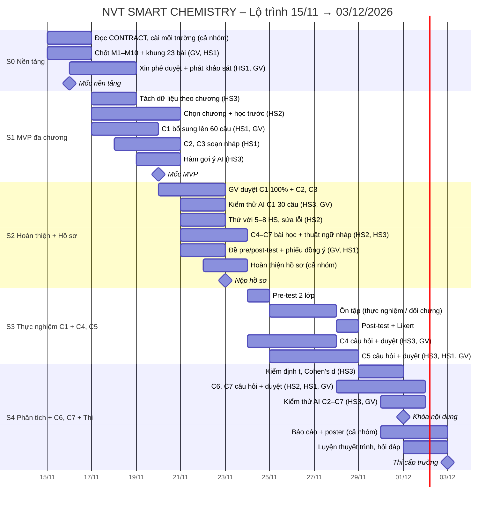

# 🗺️ Lộ trình dự án (ROADMAP)

> **Phạm vi đã điều chỉnh (15/11/2026):** sản phẩm bao phủ **toàn bộ Hóa học 10 – 7 chương, 23 bài** (SGK KNTT) để phục vụ cả **ôn tập** và **tự học trước**. **Thực nghiệm sư phạm vẫn chỉ đo trên Chương 1.**
> Thời gian: **8 ngày** đến hạn nộp hồ sơ, **khoảng 18 ngày** đến ngày thi. Nhóm chia thành 5 sprint (S0–S4) và **2 dòng việc chạy song song**:
> - **Dòng A – Nghiên cứu Chương 1:** khảo sát → hoàn thiện C1 → kiểm thử AI → thực nghiệm → phân tích. *Dòng này không được trễ.*
> - **Dòng B – Nội dung 7 chương:** mỗi chương đi qua "dây chuyền chương" (mục 3). Đây là dòng việc nhiều khối lượng nhất; **nút thắt là thời gian duyệt của GV**.
>
> Nguyên tắc ưu tiên: **Chương 1 + thực nghiệm > Chương 2, 3 > Chương 4–7 > AI > tính năng phụ.** Không bao giờ trình bày nội dung chưa duyệt như nội dung đã duyệt.

## 1. Các mốc chính (milestones)

| Mã | Ngày | Mốc | Điều kiện đạt |
|---|---|---|---|
| M-0 | CN 15/11 | Khởi động | Kế hoạch nghiên cứu 7 chương, CONTRACT, bộ tài liệu quản lý |
| M-1 | T2 16/11 | Nền tảng xong | Mỗi bạn chạy được website; GV chốt lỗi M1–M10 và khung 23 bài; phiếu khảo sát đã gửi xin phê duyệt |
| M-2 | T6 20/11 | **MVP đa chương** | Chọn chương → ôn bài → luyện tập → chẩn đoán → kết quả, chạy ở chế độ demo; dữ liệu tách theo chương; **C1 đủ 60 câu** |
| M-3 | T2 23/11 | **Nộp hồ sơ** | **C1 duyệt 100%**, C2–C3 hoàn thiện, C4–C7 có bài học + thuật ngữ bản nháp; kết quả khảo sát; báo cáo kiểm thử AI C1 |
| M-4 | T7 28/11 | Thực nghiệm xong | Dữ liệu pre/post-test, Likert, log sử dụng C1 của 2 lớp; **C4, C5 hoàn thiện** |
| M-5 | T3 01/12 | **Khóa nội dung** | **C6, C7 hoàn thiện**; kiểm thử AI C2–C7; không thêm câu mới sau mốc này |
| M-6 | ~T5 03/12 | **Thi cấp trường** | Báo cáo, poster, demo 7 chương, thuyết trình đã tập ≥ 3 lần |

## 2. Biểu đồ Gantt

## 3. Dây chuyền chương (áp dụng cho mỗi chương C1–C7)

Mỗi chương là một "story nội dung" (US-C1…US-C7 trong BACKLOG) đi qua đúng 7 bước. Trạng thái chương ghi ở bảng mục 4.

| Bước | Việc | Người | Đầu ra |
|---|---|---|---|
| ① Khung | Liệt kê bài, **yêu cầu cần đạt** (CT GDPT 2018), danh mục lỗi sai dự thảo | HS phụ trách chương | Mục chương trong `chapters.json`, lỗi sai trong `misconceptions.json` |
| ② Chốt lỗi sai | GV đọc và chốt danh mục lỗi của chương | GV | Danh mục lỗi đã chốt (ghi DEVLOG) |
| ③ Bài học + thuật ngữ | Soạn từng bài: mục tiêu, ý chính, mục nội dung, công thức, **ví dụ mẫu**, 3 câu kiểm tra nhanh; thuật ngữ có IPA | HS phụ trách | `lessons`, `terms` của chương |
| ④ Câu hỏi | Soạn đủ chỉ tiêu, đủ 3 dạng, đủ mức độ, mỗi lỗi ≥ 3 câu | HS phụ trách | `questions` của chương |
| ⑤ Kiểm tra tự động | `node docs/content/validate.js web/data` báo `ALL CHECKS PASSED` | HS phụ trách | Ảnh chụp kết quả trong PR |
| ⑥ GV duyệt | Duyệt theo lô 15–20 câu/ngày bằng phiếu duyệt của chương | GV | `reviewed: true` + phiếu duyệt |
| ⑦ Đọc thử | ≥ 3 học sinh ngoài nhóm đọc một bài, làm 10 câu, góp ý | HS2 | Góp ý + việc đã sửa |

**Chỉ tiêu mỗi chương** (xem Kế hoạch nghiên cứu mục 5.2–5.3):

| Chương | Bài | Thuật ngữ | Câu hỏi | Lỗi sai | HS phụ trách | Hạn hoàn thiện |
|---|---|---|---|---|---|---|
| C1 Cấu tạo nguyên tử | B1–B4 | 30 | 60 | M1–M10 | HS1 | **22/11** (trước thực nghiệm) |
| C2 Bảng tuần hoàn | B5–B9 | 25 | 50 | M11–M18 | HS1 | 23/11 |
| C3 Liên kết hóa học | B10–B14 | 25 | 50 | M19–M26 | HS1 | 23/11 |
| C4 Phản ứng oxi hóa – khử | B15–B16 | 15 | 35 | M27–M32 | HS3 | 28/11 |
| C5 Năng lượng hóa học | B17–B18 | 15 | 30 | M33–M37 | HS3 | 28/11 |
| C6 Tốc độ phản ứng | B19–B20 | 15 | 30 | M38–M42 | HS2 | 01/12 |
| C7 Nguyên tố nhóm VIIA | B21–B23 | 20 | 40 | M43–M48 | HS2 | 01/12 |
| **Tổng** | **23 bài** | **≈ 145** | **≈ 295** | **48** | | |

**Tải duyệt của GV (ước tính):** ≈ 295 câu × 1,5 phút + 145 thuật ngữ × 0,5 phút + 23 bài × 10 phút ≈ **12–13 giờ**, rải trong 15 ngày ≈ **50 phút/ngày**. Nếu GV không thể dành mức này, áp dụng thứ tự cắt ở mục 6.

## 4. Bảng trạng thái chương (cập nhật mỗi tối)

| Chương | ① Khung | ② Chốt lỗi | ③ Bài + thuật ngữ | ④ Câu hỏi (đã soạn/chỉ tiêu) | ⑥ Đã duyệt | ⑦ Đọc thử | Trạng thái |
|---|---|---|---|---|---|---|---|
| C1 | ✅ | 🟦 chuyên gia AI chốt, chờ GV | ✅ | 61/60 | 0/61 (chuyên gia AI đã rà 61/61) | ⬜ | 🟦 chờ GV duyệt |
| C2 | ✅ | 🟦 chuyên gia AI chốt, chờ GV | ✅ | 50/50 | 0/50 (chuyên gia AI đã rà 50/50) | ⬜ | 🟦 chờ GV duyệt |
| C3 | ✅ | 🟦 chuyên gia AI chốt, chờ GV | ✅ | 50/50 | 0/50 (chuyên gia AI đã rà 50/50) | ⬜ | 🟦 chờ GV duyệt |
| C4 | ✅ | 🟦 chuyên gia AI chốt, chờ GV | ✅ | 35/35 | 0/35 (chuyên gia AI đã rà 35/35) | ⬜ | 🟦 chờ GV duyệt |
| C5 | ✅ | 🟦 chuyên gia AI chốt, chờ GV | ✅ | 30/30 | 0/30 (chuyên gia AI đã rà 30/30) | ⬜ | 🟦 chờ GV duyệt |
| C6 | ✅ | 🟦 chuyên gia AI chốt, chờ GV | ✅ | 30/30 | 0/30 (chuyên gia AI đã rà 30/30) | ⬜ | 🟦 chờ GV duyệt |
| C7 | ✅ | 🟦 chuyên gia AI chốt, chờ GV | ✅ | 40/40 | 0/40 (chuyên gia AI đã rà 40/40) | ⬜ | 🟦 chờ GV duyệt |

## 5. Chi tiết từng sprint

### 🧱 S0 – Nền tảng (CN 15/11 – T2 16/11)

**Mục tiêu:** cả nhóm hiểu phạm vi mới (7 chương, thực nghiệm C1) và sẵn sàng làm.

| Sản phẩm | Người làm |
|---|---|
| Mỗi bạn đọc CONTRACT + tài liệu thư mục mình phụ trách | Cả nhóm |
| Repo Git, mỗi bạn clone và mở được `web/index.html` | HS3 |
| GV chốt danh mục M1–M10 và khung 23 bài (tên bài đối chiếu SGK bản in) | HS1, GV |
| Phiếu khảo sát ~15 câu (có câu về nhu cầu học trước) gửi nhà trường xin phê duyệt, phát ngay khi được đồng ý | HS1, GV |
| Mỗi bạn nhận chương phụ trách và story S1 | Cả nhóm |

**Tiêu chí hoàn thành:**
- [ ] 3/3 bạn chạy được website và tạo được 1 commit thử.
- [ ] Mỗi bạn nói được: dự án làm gì, vì sao thực nghiệm chỉ đo Chương 1, chương nào mình phụ trách.
- [ ] GV xác nhận M1–M10 và danh sách 23 bài.
- [ ] Phiếu khảo sát đã được nhà trường đồng ý (hoặc đã nộp xin phép).

### 🚀 S1 – MVP đa chương (T3 17/11 – T6 20/11)

**Mục tiêu:** bản chạy được từ đầu đến cuối ở **chế độ demo** với cấu trúc 7 chương; Chương 1 đủ câu hỏi.

| Sản phẩm | Người làm |
|---|---|
| Tách dữ liệu theo chương (`chapters.json` + thư mục `web/data/c1/…`), cập nhật `content.js`, `validate.js` (US-23) | HS3 |
| Trang chủ chọn chương, tiến độ theo chương, chế độ "Học trước" (US-24, US-25) | HS2 |
| Luyện tập, chẩn đoán, gợi ý soạn sẵn, kết quả chạy cho mọi chương (US-04…US-09) | HS2 |
| C1: bổ sung 20 câu (ưu tiên B4, M6), bổ sung ví dụ mẫu và kiểm tra nhanh cho B1–B4 | HS1 |
| C2, C3: khung + bài học + thuật ngữ + câu hỏi bản nháp | HS1 |
| `schema.sql` có cột chương; Edge Function `hint` | HS3 |
| Tổng hợp khảo sát | HS1 |

**Tiêu chí hoàn thành:**
- [ ] Mọi story **Must** của S1 đạt Definition of Done.
- [ ] Demo trọn luồng trên điện thoại thật cho C1 và ít nhất 1 chương khác.
- [ ] C1 có 60 câu, ít nhất 30 câu đã `reviewed: true`.
- [ ] Không có khóa API nào trong `web/`.

### ✨ S2 – Hoàn thiện, kiểm thử AI, hồ sơ (T7 21/11 – T2 23/11)

| Sản phẩm | Người làm |
|---|---|
| **C1 duyệt 100%**; C2, C3 duyệt và đọc thử | GV, HS1 |
| Báo cáo kiểm thử AI C1 (30 câu) | HS3, GV |
| Thử nghiệm với 5–8 học sinh, sửa lỗi | HS2 |
| C4, C5 (HS3) và C6, C7 (HS2): khung, bài học, thuật ngữ bản nháp | HS3, HS2 |
| Dashboard GV lọc theo chương + xuất CSV | HS2, HS3 |
| Đề pre/post-test C1 (20 + 10 câu), phiếu Likert, phiếu đồng ý | GV, HS1 |
| Hồ sơ dự thi; DEVLOG, AI_USAGE_LOG cập nhật | Cả nhóm |

**Tiêu chí hoàn thành:**
- [ ] Hồ sơ nộp trước hạn 23/11.
- [ ] 100% câu C1 dùng trong thực nghiệm đã `reviewed: true`.
- [ ] Báo cáo kiểm thử AI ghi số liệu **thật**.
- [ ] Bản giấy dự phòng pre/post-test đã in.

### 🧪 S3 – Thực nghiệm C1 + hoàn thiện C4, C5 (T3 24/11 – T7 28/11)

**Mục tiêu:** dữ liệu thực nghiệm sạch; đồng thời hoàn thiện C4, C5. **Khi xung đột thời gian, thực nghiệm luôn được ưu tiên.**

| Ngày | Dòng A – Thực nghiệm C1 | Dòng B – Nội dung |
|---|---|---|
| T3 24/11 | Pre-test 2 lớp (~25 phút) | C4: câu hỏi (HS3) |
| T4 25/11 – T6 27/11 | Lớp thực nghiệm: 1 buổi phòng máy + tự ôn C1 ở nhà. Lớp đối chứng: phiếu cùng nội dung, cùng thời lượng | C4 duyệt; C5 câu hỏi + duyệt |
| T7 28/11 | Post-test + Likert | C6, C7: bắt đầu câu hỏi |

**Lưu ý thiết kế:** trong tuần thực nghiệm, lớp thực nghiệm chỉ được giao Chương 1 (các chương khác có thể đã hiện trên web nhưng không giao bài) để so sánh công bằng với lớp đối chứng.

**Tiêu chí hoàn thành:**
- [ ] Điểm pre/post của cả 2 lớp ghép theo mã ẩn danh.
- [ ] Log sử dụng xuất CSV, sao lưu 2 nơi.
- [ ] Sự cố ghi vào DEVLOG.
- [ ] C4, C5 đạt tiêu chuẩn "chương hoàn thiện".

### 📊 S4 – Phân tích, C6–C7, poster, thuyết trình (CN 29/11 – ~T5 03/12)

| Sản phẩm | Người làm |
|---|---|
| Thống kê mô tả, t ghép cặp, t độc lập, Cohen's d; biểu đồ lỗi M1–M10 trước/sau | HS3 |
| C6, C7 hoàn thiện; kiểm thử AI C2–C7 (5 câu/chương) | HS2, HS1, HS3, GV |
| Mở nền tảng cho khối 10 tự nguyện dùng; bắt đầu thu dữ liệu sử dụng C2–C7 | GV, HS3 |
| Báo cáo cuối (có mục Hạn chế) + poster | Cả nhóm |
| Kịch bản demo 3 phút: 1 lượt ôn C1 có chẩn đoán + 1 lượt "học trước" một chương khác; có phương án offline | HS2 |
| Luyện hỏi đáp theo [JUDGE_PREP.md](JUDGE_PREP.md) ≥ 3 lần | Cả nhóm |

**Tiêu chí hoàn thành:**
- [ ] Mỗi con số trên poster truy ngược được về file dữ liệu gốc.
- [ ] Poster ghi đúng **số câu đã duyệt / tổng số câu** của từng chương.
- [ ] Mỗi bạn trả lời được câu hỏi về chương mình phụ trách mà không đọc giấy.
- [ ] Demo chạy được khi không có Internet.

## 6. Nếu bị trễ thì cắt gì? (thứ tự cắt)

1. Cắt các story **Could**.
2. C6, C7 chưa duyệt kịp → vẫn hiển thị với nhãn **"Bản nháp – chưa duyệt"**, hoàn thiện trong học kì 2 *trước khi lớp học đến chương đó*.
3. Giảm chỉ tiêu câu hỏi C4–C7 xuống ~70% (ưu tiên đủ mỗi lỗi ≥ 3 câu), không cố đủ số lượng bằng câu chưa duyệt kỹ.
4. AI gợi ý: chỉ giữ gợi ý soạn sẵn + lời giải đã duyệt; tắt AI ở chương chưa kiểm thử.
5. Dashboard giáo viên: thay bằng xuất CSV + bảng tính.
6. **Không bao giờ cắt:** Chương 1 và thực nghiệm, chẩn đoán lỗi sai, kiểm duyệt của GV, nhãn "Chưa duyệt", ẩn danh học sinh, báo cáo trung thực.

## 7. Sau ngày thi (học kì 2)

| Thời gian | Việc |
|---|---|
| Tháng 12 | Hoàn thiện chương còn nhãn "Chưa duyệt"; thu dữ liệu sử dụng C2–C7 |
| Trước khi lớp học đến mỗi chương | Rà lại chương đó với dữ liệu lỗi sai thực tế, hiệu chỉnh danh mục M11–M48 |
| Nếu đi tiếp vòng trên | Mở rộng thực nghiệm (thêm lớp, thêm chương, kiểm tra lại sau 3–4 tuần) |
