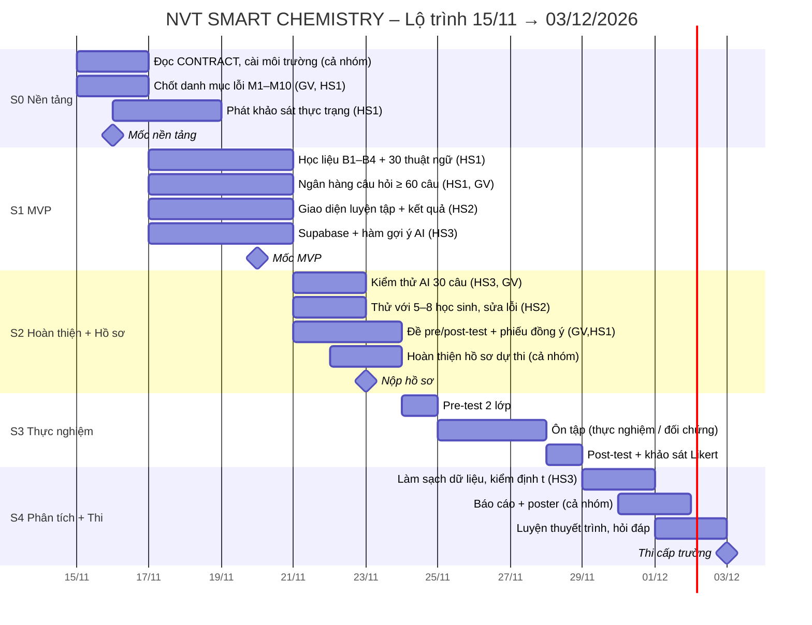

# 🗺️ Lộ trình dự án (ROADMAP)

> Thời gian rất ngắn: **8 ngày** đến hạn nộp hồ sơ, **khoảng 18 ngày** đến ngày thi. Vì vậy nhóm chia thành 5 sprint ngắn (S0–S4). Mỗi sprint có **mục tiêu**, **sản phẩm**, **tiêu chí hoàn thành** và **người chịu trách nhiệm chính**.
> Nguyên tắc ưu tiên (theo Kế hoạch nghiên cứu, mục 11): **luyện tập chẩn đoán + thống kê là cốt lõi; AI gợi ý là phần bổ sung.** Nếu thiếu thời gian, cắt AI trước, không cắt phần chẩn đoán.

## 1. Các mốc chính (milestones)

| Mã | Ngày | Mốc | Điều kiện đạt |
|---|---|---|---|
| M-0 | CN 15/11 | Khởi động | Có kế hoạch nghiên cứu, CONTRACT, bộ tài liệu quản lý, bản nháp kiến trúc/nội dung/giao diện |
| M-1 | T2 16/11 | Nền tảng xong | Mỗi bạn chạy được website ở máy mình; danh mục lỗi M1–M10 được GV chốt; khảo sát đã phát |
| M-2 | T6 20/11 | **MVP** | Học sinh ôn bài, luyện tập, xem chẩn đoán và kết quả ở chế độ demo (không cần Supabase) |
| M-3 | T2 23/11 | **Nộp hồ sơ** | Hồ sơ + sản phẩm thí điểm + kết quả khảo sát + báo cáo kiểm thử AI |
| M-4 | T7 28/11 | Thực nghiệm xong | Có dữ liệu pre-test, post-test, khảo sát Likert, log sử dụng của 2 lớp |
| M-5 | ~T5 03/12 | **Thi cấp trường** | Báo cáo, poster, demo, thuyết trình đã tập ít nhất 3 lần |

## 2. Biểu đồ Gantt

## 3. Chi tiết từng sprint

### 🧱 S0 – Nền tảng (CN 15/11 – T2 16/11)

**Mục tiêu:** cả nhóm hiểu dự án, hiểu bộ khung đã có, và sẵn sàng bắt tay làm.
**Chịu trách nhiệm chính:** GV (định hướng) + HS3 (môi trường kỹ thuật).

| Sản phẩm | Người làm |
|---|---|
| Mỗi bạn đọc CONTRACT + tài liệu thư mục mình phụ trách, ghi câu hỏi chưa hiểu | Cả nhóm |
| Repo Git (GitHub) có `main`, mỗi bạn clone và mở được `web/index.html` | HS3 |
| Danh mục lỗi sai M1–M10 được GV đọc và chốt (có thể sửa tên/mô tả) | HS1, GV |
| Phiếu khảo sát thực trạng ~15 câu (Google Forms) đã phát | HS1 |
| Backlog được cả nhóm đọc, mỗi bạn nhận story S1 của mình | Cả nhóm |

**Tiêu chí hoàn thành:**
- [ ] 3/3 bạn chạy được website ở máy mình và tạo được 1 commit thử.
- [ ] Mỗi bạn giải thích được bằng lời: dự án làm gì, phần mình phụ trách là gì.
- [ ] GV xác nhận danh mục M1–M10.
- [ ] Link khảo sát đã gửi cho ít nhất 1 lớp 10.

### 🚀 S1 – MVP (T3 17/11 – T6 20/11)

**Mục tiêu:** có bản chạy được từ đầu đến cuối ở **chế độ demo**: vào bằng mã lớp → ôn bài → luyện tập → thấy chẩn đoán lỗi sai → xem kết quả.
**Chịu trách nhiệm chính:** HS2 (tích hợp sản phẩm).

| Sản phẩm | Người làm |
|---|---|
| `lessons.json` B1–B4, `terms.json` ~30 thuật ngữ, `misconceptions.json` | HS1 |
| `questions.json` ≥ 60 câu, mỗi phương án nhiễu gắn mã lỗi; GV duyệt dần | HS1, GV |
| Trang đăng nhập, ôn bài, thuật ngữ, luyện tập, kết quả (demo `localStorage`) | HS2 |
| `schema.sql` chạy được trên Supabase; `store.js` ghi kết quả lên Supabase khi có cấu hình | HS3 |
| Edge Function `hint` trả gợi ý mức 1–3, có giới hạn lượt | HS3 |
| Tổng hợp kết quả khảo sát (bảng + biểu đồ đơn giản) | HS1 |

**Tiêu chí hoàn thành:**
- [ ] Tất cả story **Must** của S1 trong BACKLOG đạt Definition of Done.
- [ ] Demo trọn luồng trên điện thoại thật, không lỗi đỏ trong Console.
- [ ] Ít nhất 30 câu đã `reviewed: true`.
- [ ] Không có khóa API nào trong thư mục `web/`.

### ✨ S2 – Hoàn thiện, kiểm thử AI, hồ sơ (T7 21/11 – T2 23/11)

**Mục tiêu:** sản phẩm đủ ổn để dùng thật trong lớp; hồ sơ nộp đúng hạn.
**Chịu trách nhiệm chính:** cả nhóm; HS1 điều phối hồ sơ.

| Sản phẩm | Người làm |
|---|---|
| Báo cáo kiểm thử AI trên 30 câu (tỉ lệ đúng, tỉ lệ lộ đáp án sớm, từ chối ngoài phạm vi) | HS3, GV |
| Thử nghiệm với 5–8 học sinh, danh sách lỗi và việc đã sửa | HS2 |
| Dashboard giáo viên + xuất CSV | HS2, HS3 |
| Đề pre-test và post-test (20 câu kiến thức + 10 câu thuật ngữ), phiếu Likert, phiếu đồng ý | GV, HS1 |
| Hồ sơ dự thi hoàn chỉnh; DEVLOG và AI_USAGE_LOG cập nhật | Cả nhóm |

**Tiêu chí hoàn thành:**
- [ ] Hồ sơ nộp trước hạn 23/11.
- [ ] 100% câu dùng trong thực nghiệm đã `reviewed: true`.
- [ ] Báo cáo kiểm thử AI ghi số liệu **thật** (kể cả khi AI làm chưa tốt).
- [ ] Bản giấy dự phòng pre/post-test đã in.

### 🧪 S3 – Thực nghiệm (T3 24/11 – T7 28/11)

**Mục tiêu:** thu dữ liệu sạch, đúng quy trình, đúng đạo đức nghiên cứu.
**Chịu trách nhiệm chính:** GV (tổ chức lớp) + HS3 (dữ liệu).

| Ngày | Việc |
|---|---|
| T3 24/11 | Pre-test cả 2 lớp (cùng đề, cùng thời gian ~15 phút) |
| T4 25/11 – T6 27/11 | Lớp thực nghiệm: 1 buổi trên phòng máy + tự ôn ở nhà. Lớp đối chứng: phiếu bài tập cùng nội dung, cùng thời lượng |
| T7 28/11 | Post-test + khảo sát Likert 5 mức |

**Tiêu chí hoàn thành:**
- [ ] Có điểm pre-test và post-test của cả 2 lớp, ghép theo mã ẩn danh.
- [ ] Log sử dụng (lượt luyện, lỗi sai, mức gợi ý) đã xuất CSV và sao lưu 2 nơi.
- [ ] Ghi lại mọi sự cố (mất mạng, học sinh vắng…) vào DEVLOG – đây là dữ liệu cho phần "hạn chế".

### 📊 S4 – Phân tích, poster, thuyết trình (CN 29/11 – ~T5 03/12)

**Mục tiêu:** biến dữ liệu thành kết luận trung thực và trình bày tự tin.
**Chịu trách nhiệm chính:** HS3 (phân tích) + HS1 (poster) + HS2 (demo).

| Sản phẩm | Người làm |
|---|---|
| Bảng thống kê mô tả, kiểm định t ghép cặp, t độc lập, Cohen's d | HS3 |
| Biểu đồ tỉ lệ lỗi M1–M10 trước/sau | HS3, HS1 |
| Báo cáo cuối (có mục Hạn chế) + poster | Cả nhóm |
| Kịch bản demo 3 phút (có phương án dự phòng không cần mạng) | HS2 |
| Luyện hỏi đáp theo [JUDGE_PREP.md](JUDGE_PREP.md) ít nhất 3 lần, có GV đóng vai giám khảo | Cả nhóm |

**Tiêu chí hoàn thành:**
- [ ] Mỗi con số trên poster truy ngược được về file dữ liệu gốc.
- [ ] Mỗi bạn trả lời được câu hỏi nhóm mình dẫn dắt mà không đọc giấy.
- [ ] Demo chạy được cả khi không có Internet (chế độ demo).

## 4. Nếu bị trễ thì cắt gì? (thứ tự cắt)

1. Cắt các story **Could** (xem BACKLOG).
2. Giảm số câu hỏi xuống 60 câu đã duyệt kỹ (không cố đủ 80 câu chưa duyệt).
3. AI gợi ý: chỉ giữ mức 3 dựa trên lời giải đã duyệt (không gọi AI) – vẫn giữ "thang 3 mức" bằng gợi ý soạn sẵn.
4. Dashboard giáo viên: thay bằng xuất CSV + bảng tính.
5. **Không bao giờ cắt:** chẩn đoán lỗi sai, kiểm duyệt nội dung của GV, ẩn danh học sinh, báo cáo trung thực.
