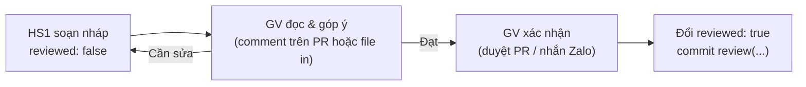

# 🤝 Quy trình làm việc của nhóm

> Nhóm nhỏ, thời gian ngắn, lại trùng lịch kiểm tra trên lớp → cần quy trình **đơn giản nhưng đều đặn**. Đọc kỹ một lần, sau đó chỉ cần nhớ 3 việc: **báo cáo ngắn mỗi ngày · làm trên nhánh riêng · nhờ bạn review trước khi gộp vào main.**

## 1. Vai trò và bảng RACI

**Vai trò chính**

| Thành viên | Vai trò | Phụ trách |
|---|---|---|
| **HS1** | Nội dung & nghiên cứu | Điều phối nội dung 7 chương; học liệu, thuật ngữ, câu hỏi **C1, C2, C3**; khảo sát; điều phối hồ sơ |
| **HS2** | Giao diện & trải nghiệm | Các trang web, chọn chương, học trước, luyện tập, chẩn đoán, kết quả, dashboard, kịch bản demo; nội dung **C6, C7** |
| **HS3** | Dữ liệu & AI | Supabase, `store.js`, tách dữ liệu theo chương, Edge Function gợi ý AI, kiểm thử AI, xuất CSV, phân tích thống kê; nội dung **C4, C5** |
| **GV** | Hướng dẫn | Định hướng, chốt danh mục lỗi sai, kiểm duyệt toàn bộ nội dung Hóa học 7 chương (≈ 50 phút/ngày), duyệt đề kiểm tra, tổ chức khảo sát và thực nghiệm |

**RACI** – **R** = làm chính · **A** = chịu trách nhiệm cuối, người "chốt" · **C** = được hỏi ý kiến · **I** = được thông báo

| Công việc | HS1 | HS2 | HS3 | GV |
|---|---|---|---|---|
| Danh mục lỗi sai M1–M48 (mỗi chương do HS phụ trách soạn) | R | C | C | A |
| Nội dung C1–C3 | R | I | I | A |
| Nội dung C4–C5 | C | I | R | A |
| Nội dung C6–C7 | C | R | I | A |
| Ngân hàng câu hỏi | R | I | C | A |
| Giao diện, luyện tập, kết quả | C | R/A | C | I |
| Cơ sở dữ liệu, `store.js` | I | C | R/A | I |
| Trợ lý AI gợi ý (Edge Function) | C | C | R/A | C |
| Kiểm thử AI (30 câu) | C | I | R | A |
| Khảo sát thực trạng | R/A | I | C | C |
| Đề pre/post-test, phiếu Likert | R | I | C | A |
| Tổ chức thực nghiệm | C | C | C | R/A |
| Phân tích số liệu | C | C | R/A | C |
| Hồ sơ dự thi | R/A | R | R | C |
| Poster, thuyết trình | R | R | R | A |
| DEVLOG, AI_USAGE_LOG | R | R | R | A |

## 2. Họp nhanh hằng ngày (10 phút)

Có thể họp trực tiếp giờ ra chơi **hoặc** nhắn trong nhóm Zalo trước **21:00** mỗi ngày. Mỗi bạn gửi đúng mẫu sau:

```
📅 [Ngày] – [HS?]
✅ Hôm qua: (đã xong gì, ghi mã US-xx)
🎯 Hôm nay: (sẽ làm gì, ghi mã US-xx)
🚧 Vướng: (không có / mô tả ngắn – cần ai giúp?)
⏱️ Thời gian rảnh hôm nay: (ví dụ 19:30–21:30)
```

Quy tắc:
- Ngắn gọn, không quá 5 dòng.
- Có "Vướng" → người liên quan trả lời trong ngày. Vướng quá 30 phút thì nhắn ngay, không đợi đến tối.
- Thứ Bảy và trước ngày kiểm tra trên lớp: được phép ghi "Hôm nay ôn thi, không làm dự án". **Việc học chính khóa luôn quan trọng hơn.**
- Mỗi ngày một bạn trực, chép tóm tắt vào [DEVLOG.md](DEVLOG.md) (luân phiên HS1 → HS2 → HS3).

## 3. Quy trình Git cho người mới

### 3.1. Mô hình nhánh
- `main`: luôn **chạy được**. Không ai commit trực tiếp vào `main`.
- Nhánh làm việc: `feature/US-04-mcq`, `content/B2-cau-hoi`, `fix/loi-dau-phay` …

### 3.2. Các bước mỗi lần làm một việc

```bash
git checkout main
git pull                              # 1. lấy bản mới nhất
git checkout -b feature/US-04-mcq     # 2. tạo nhánh riêng
# ... sửa code, mở trình duyệt thử ...
git status                            # 3. xem đã sửa những file nào
git add web/js/practice.js            # 4. chọn đúng file (tránh "git add ." khi chưa xem status)
git commit -m "feat(luyen-tap): chấm câu nhiều lựa chọn (US-04)"
git push -u origin feature/US-04-mcq  # 5. đẩy lên GitHub
# 6. Lên GitHub → mở Pull Request → nhờ một bạn khác review
```

### 3.3. Quy ước commit (tiếng Việt)

Mẫu: `loại(phạm-vi): mô tả ngắn (US-xx)`

| Loại | Dùng khi | Ví dụ |
|---|---|---|
| `feat` | Thêm chức năng | `feat(thuat-ngu): thêm nút phát âm (US-03)` |
| `fix` | Sửa lỗi | `fix(luyen-tap): chấp nhận dấu phẩy thập phân (US-04)` |
| `content` | Thêm/sửa học liệu, câu hỏi | `content(B2): thêm 12 câu đồng vị, gắn M4–M5 (US-06)` |
| `review` | GV duyệt nội dung | `review(B2): GV duyệt Q-B2-001…012` |
| `docs` | Sửa tài liệu | `docs(devlog): ghi nhật ký 17/11` |
| `style` | Chỉnh giao diện, không đổi logic | `style(ket-qua): tăng cỡ chữ trên điện thoại` |
| `test` | Kiểm thử | `test(ai): thêm 10 câu kiểm thử ngoài phạm vi (US-18)` |

Mô tả viết ở thể **làm gì**, ngắn, có dấu. Nếu commit có phần do AI gợi ý, thêm dòng cuối `AI: có – xem AI_USAGE_LOG 17/11`.

### 3.4. Pull Request và review
- Mỗi PR **nhỏ** (lý tưởng dưới 200 dòng thay đổi) và gắn với 1 story.
- Mô tả PR gồm: làm gì, đã thử thế nào (ảnh chụp màn hình nếu là giao diện), có dùng AI không.
- **Người review phải là một bạn khác.** Gợi ý ghép: HS2 ↔ HS3 review code cho nhau; HS1 review văn bản/nội dung hiển thị; GV review nội dung Hóa học.
- Người review: tải nhánh về chạy thử, đọc từng dòng, hỏi "dòng này làm gì?" nếu chưa rõ. Tác giả phải trả lời được – đây cũng là buổi luyện cho vòng hỏi đáp với giám khảo.
- Gặp xung đột (conflict)? Đừng hoảng – nhắn HS3, cùng nhau sửa trong 10 phút.

## 4. Phân bổ thời gian hợp lý
- Mỗi bạn dự kiến **2–4 giờ/ngày** ngoài giờ học. Ghi rõ lịch kiểm tra trên lớp vào nhóm để cả nhóm biết.
- Nếu một bạn bị quá tải → báo ngay trong mục 🚧, nhóm chia lại việc hoặc cắt story theo [ROADMAP mục 4](ROADMAP.md#4-nếu-bị-trễ-thì-cắt-gì-thứ-tự-cắt).
- Không thức quá 23:00 để code. Code buổi khuya hay sinh lỗi.

## 5. Definition of Ready và Definition of Done

### ✋ Definition of Ready – story **sẵn sàng để bắt đầu** khi:
- [ ] Có ID, người làm, ưu tiên, ước lượng.
- [ ] Tiêu chí nghiệm thu rõ ràng, kiểm tra được bằng thao tác cụ thể.
- [ ] Dữ liệu/nội dung cần dùng đã có (ít nhất bản nháp), hoặc biết dùng dữ liệu mẫu nào.
- [ ] Người làm hiểu story và đã hỏi lại những chỗ chưa rõ.
- [ ] Ước lượng ≤ L. Nếu lớn hơn → chia nhỏ.

### ✅ Definition of Done – story **xong** khi:
- [ ] Mọi tiêu chí nghiệm thu đã được thử thật và đạt.
- [ ] Chạy được trên **điện thoại** (Chrome Android) và **máy tính** (Chrome/Edge), ở cả chế độ demo.
- [ ] Console trình duyệt không có lỗi đỏ.
- [ ] Code đọc từ `web/data/*.json` / `store.js` đúng CONTRACT; không viết cứng nội dung Hóa học vào JS.
- [ ] Không có khóa API, mật khẩu, họ tên học sinh trong code.
- [ ] Đã được **một bạn khác** review và gộp vào `main`.
- [ ] Tác giả **giải thích được từng dòng** mình nộp.
- [ ] Nếu có dùng AI → đã ghi [AI_USAGE_LOG.md](AI_USAGE_LOG.md).
- [ ] Cập nhật trạng thái trong [BACKLOG.md](BACKLOG.md) thành ✅.

## 6. Quy trình kiểm duyệt nội dung

Mọi nội dung Hóa học (bài học, thuật ngữ, câu hỏi, lời giải, lỗi sai) đi qua 4 bước:



1. **HS1 soạn** trên nhánh `content/...`, giữ `reviewed: false`. Nguồn: SGK Hóa học 10 KNTT; ghi nguồn nếu dùng tài liệu khác.
2. **Gửi GV** theo lô nhỏ (10–15 câu/lô). GV có thể duyệt trên GitHub hoặc trên bản in/bảng tính – HS1 xuất giúp.
3. **GV góp ý** về: đúng kiến thức, đáp án, phương án nhiễu có thật sự phản ánh lỗi sai không, từ ngữ phù hợp học sinh lớp 10.
4. **Chỉ sau khi GV xác nhận** mới đổi `reviewed: true`. Commit có dạng `review(B2): GV duyệt Q-B2-001…012 ngày 18/11`. Lưu ảnh chụp tin nhắn xác nhận của GV nếu duyệt qua Zalo.

⚠️ Không bao giờ tự đổi `reviewed: true` thay GV. Nội dung do AI gợi ý **cũng phải qua đúng quy trình này** và được ghi vào AI_USAGE_LOG.

## 7. Dùng công cụ AI một cách trung thực

Dự án **được phép** và **công khai** dùng AI (Claude, ChatGPT, Copilot…) để học, gợi ý code, rà lỗi, soạn nháp. Nhưng có 5 nguyên tắc:

1. **Hiểu trước, commit sau.** Em phải hiểu và giải thích được *từng dòng* em commit. Không hiểu → hỏi AI giải thích, hỏi bạn, hỏi GV, hoặc viết lại theo cách của em.
2. **Ghi lại ngay.** Mỗi lần AI đóng góp đáng kể (một hàm, một đoạn văn, một bộ câu hỏi nháp) → ghi một dòng vào [AI_USAGE_LOG.md](AI_USAGE_LOG.md) trong ngày.
3. **Kiểm chứng.** Code AI viết phải chạy thử; kiến thức Hóa học AI viết phải đối chiếu SGK và qua GV duyệt. AI có thể sai một cách rất tự tin.
4. **Không đưa dữ liệu cá nhân vào AI.** Không dán điểm, mã học sinh, danh sách lớp vào công cụ AI.
5. **Không bịa số liệu.** Không bao giờ nhờ AI "tạo kết quả thực nghiệm" hay "điền số cho đẹp". Số liệu trong báo cáo chỉ đến từ dữ liệu thật.

> 💬 Mẹo tự kiểm tra: đóng cửa sổ AI lại, rồi giải thích đoạn code đó cho một bạn trong nhóm trong 1 phút. Làm được → em đã sở hữu nó.
